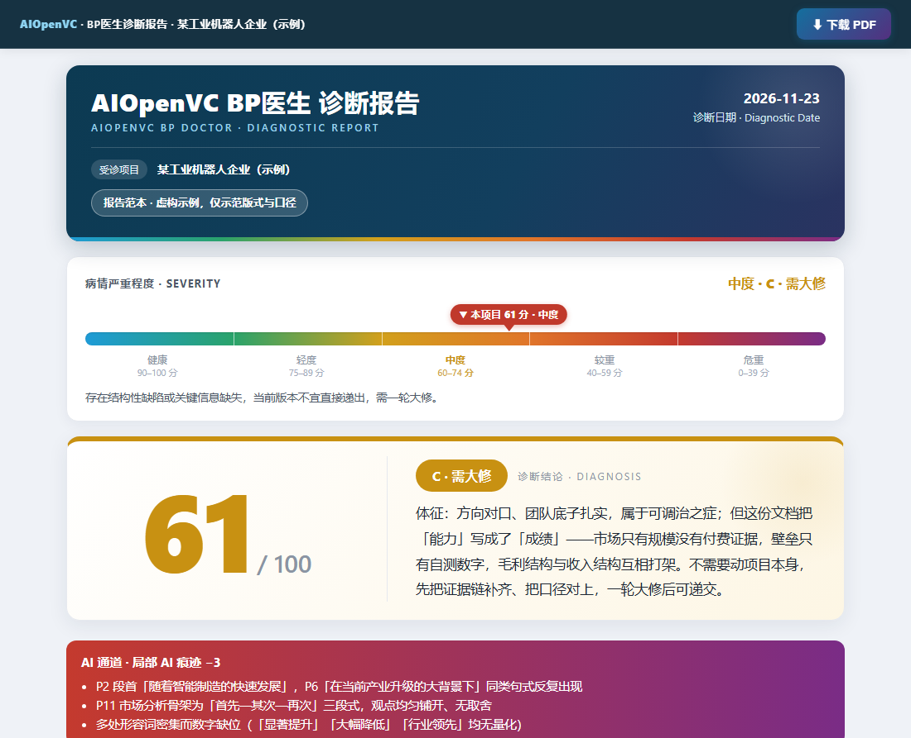

# BP Doctor · AIOpenVC

> What is your business plan actually worth?

**Scores a business plan, locates what's broken, and prescribes fixes.** Outputs a single-file HTML diagnostic report (with PDF export) plus a structured markdown record that supports version-to-version comparison.

[中文文档](README.md) · [Sample report](examples/sample-report.html)



## What it does

`BP Doctor` is not a writing assistant and does not tell you whether to invest. It evaluates one thing: **how well this document communicates a project to an investor.**

Total 100 points, split in two:

- **65 points — the project and its logic**: team, market, policy fit, solution and moat, business model, competition, financing, cap table, risk awareness.
- **35 points — the document itself**, counted down from full marks: branding, layout, missing sections, phrasing, internal consistency, AI-generated feel.

Two separate channels run outside the dimension scores:

- **Red lines** (undisclosed dual employment, contradictory revenue figures, etc.): −10 each.
- **AI filler**: −3 / −8 / −15, flagged next to the total with the specific textual signals, never buried inside a dimension.

## Design rules

1. The total score is the largest element on the page. No exceptions.
2. **Never fabricate data.** Missing stays missing — the tool asks instead of guessing. A flattering report is worse than none.
3. **Every prescription must be an action**: what to change, how to change it, and what counts as passing. "Strengthen" and "optimize" are banned as standalone verbs.
4. Zero tolerance for AI filler — a plan that is everywhere correct and nowhere specific has not respected the reader's time.

## Quick start

Requires Python 3.8+. No third-party dependencies.

```bash
git clone https://github.com/<your-name>/opvc-bp-doctor.git
cd opvc-bp-doctor

# Render the bundled sample
python scripts/render_report.py --data assets/sample-diagnosis.json --outdir out
```

Output:

```
out/BP诊断报告_范本_20261123.html   # single file, open in browser, PDF button top-right
out/BP病历_范本_20261123_v1.md      # structured record, auto-increments on re-diagnosis
```

Run it again with a new dataset and the record version bumps to `v2`, with a per-dimension diff against `v1` included automatically.

Add `--public` to redact all identifiable names via the `public_profile.redactions` word list and emit a shareable version. The bundled sample ships without that list, so the project name falls back to a generic placeholder — add `public_profile` to your own dataset.

The report is generated in Chinese. The scoring rubric lives in [`references/scoring.md`](references/scoring.md); the JSON schema in [`references/data_schema.md`](references/data_schema.md).

## Using it as a WorkBuddy skill

Clone into your WorkBuddy skills directory:

```bash
# Windows
%USERPROFILE%\.workbuddy\skills\opvc-bp-doctor
# macOS
~/.workbuddy/skills/opvc-bp-doctor
```

Then drop a business plan into the chat and ask it to diagnose. The skill asks up to 8 clarifying questions first (industry, stage, audience), then produces the report.

## Repository layout

```
SKILL.md                    skill definition: role, rules, 6-step workflow, visual spec
references/scoring.md       the rubric — single source of truth
references/data_schema.md   diagnostic JSON structure
references/versioning.md    record matching and version bump rules
assets/                     report template, record template, sample data
scripts/render_report.py    renderer: JSON → HTML + MD
examples/                   a full rendered sample (HTML / PDF / MD)
```

## Scope

- No invest / pass recommendation.
- No due diligence: no corporate registry, litigation, or patent lookups.
- No fabricated numbers.

Scores measure the document, not the company. A good project that is badly written will score low — that is the point.

## License

[MIT](LICENSE) © 一觉同学 / AIOpenVC

<sub>Sample report uses a fictional company. Nothing here is investment advice.</sub>
