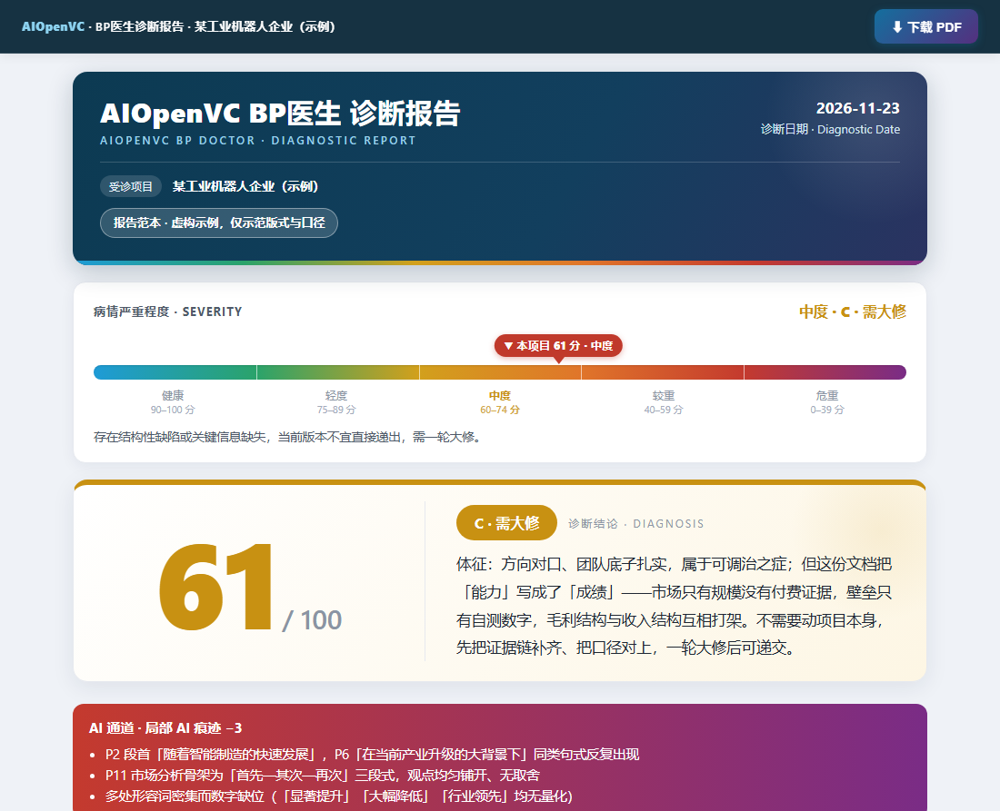
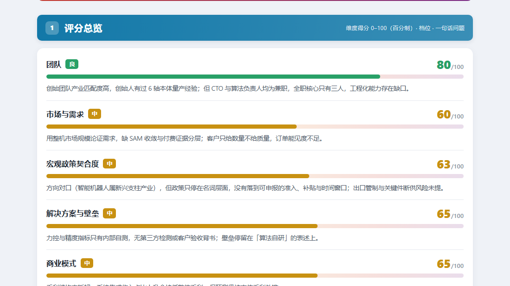
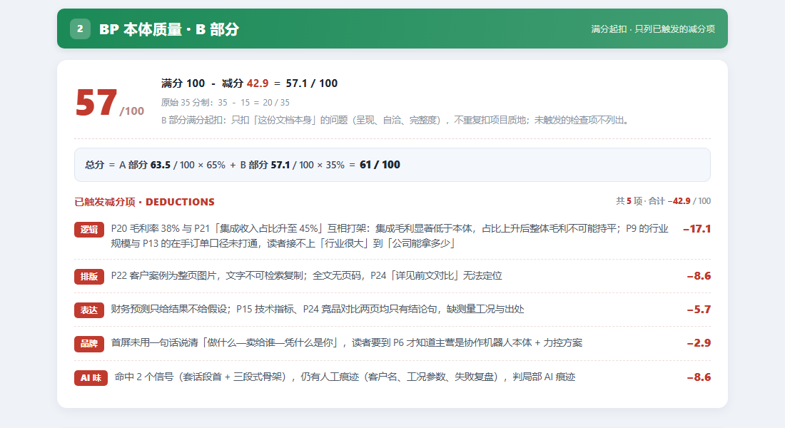
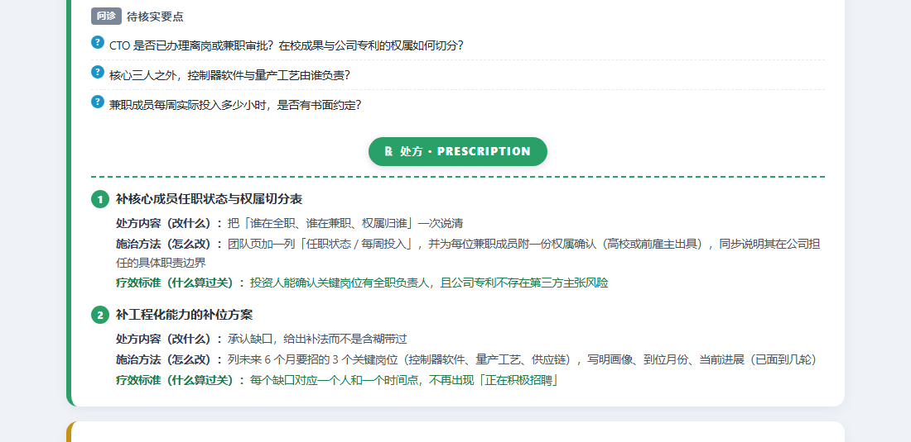
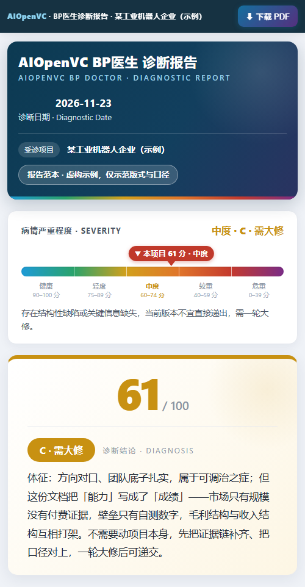

# BP 医生 · AIOpenVC

> 一份商业计划书，值几分？

**给商业计划书打分、找病灶、开处方。** 输出一份单文件 HTML 诊断报告（带 PDF 下载）和一份可版本对照的结构化病历。

- **100 分制**：65 分给项目与逻辑，35 分给这份文档本身
- **四个维度之外还有红线**：关键人物兼职未披露、数据自相矛盾等，命中每条 −10
- **AI 敷衍独立扣分**：−3 / −8 / −15，不藏在维度分里
- **零依赖**：渲染器只用 Python 标准库，不需要 `pip install` 任何东西

<a href="docs/screenshots/01-hero.png"></a>

---

## 为什么做这个

投资人拒绝一个项目的时候，通常不会说理由。不是傲慢——说清楚要得罪人、要解释、要接住追问，所以行业里最省事的做法是不说。

结果是：创业者只有一次机会，却拿不到任何反馈。BP 大概是创业过程中唯一一个产品——**你既是生产者，又是唯一的质检员，而这个质检员手里没有标准。**

这个项目就是把标准摊开：把「一个投资人会怎么看这份文档」拆成可以逐项核对的分数、可以追溯位置的证据、可以执行到位的修改动作。

它不判断投不投。它只判断一份 BP 作为「向投资人传递信息」的工具，做到了什么程度。

---

## 它做什么 / 不做什么

| 做 | 不做 |
|---|---|
| 给 9 个项目维度打分，每项附 BP 页码或原句 | 不判断这个项目值不值得投 |
| 指出这份文档本身的 6 类问题（品牌/排版/缺项/表达/逻辑/AI 味） | 不替你编数据，缺失就标缺失并追问 |
| 每个维度给 2–3 条处方：改什么 / 怎么改 / 什么算过关 | 不给「加强、完善、优化」这类无效建议 |
| 生成 HTML 报告 + md 病历，复诊自动做版本对照 | 不做尽调，不查工商、不查诉讼 |
| 一键脱敏，输出可公开的对外展示版 | 不暴露原始公司名、人名、机构名 |

---

## 评分体系

总分 100 ＝ **A 部分 65（项目与逻辑）＋ B 部分 35（文档质量）**

| 部分 | 维度 | 分值 |
|---|---|---|
| **A · 项目与逻辑** | 团队 15 · 市场与需求 17 · 宏观政策契合度 10 · 解决方案与壁垒 14 · 商业模式 15 · 竞品与替代 7 · 融资与资金用途 12 · 股权与控制权 6 · 风险自知 4 | 65 |
| **B · 文档质量** | 满分 35 起扣，只扣这份文档本身的问题 | 35 |

A 部分的权重会按阶段（想法 / MVP / 有收入 / 增长）和用途（融资 / 参赛 / 政策申报）调整，**调整后总和仍为 100%**。B 部分按「满分 35 起扣」记账，**只列已触发的减分项**——读者看到几条，就是这份 BP 失分的全部。

**等级映射**：A ≥ 85 / B 70–84 / C 55–69 / D 40–54 / E < 40。报告里不出现「E」，最低档统一显示为「D · 建议重构」。

**两条独立通道**（不占维度分）：

- **红线**：核心数据与公开信息矛盾、关键人物兼职/竞业未披露、股权存在明显代持、财务口径自相矛盾等，命中每条在 A 部分额外 −10。
- **AI 敷衍**：局部痕迹 −3，主体像 AI 生成 −8，通篇敷衍 −15，独立挂在总分旁并列出具体文本信号。

完整口径见 [`references/scoring.md`](references/scoring.md)。

---

## 快速开始

### 方式一：作为 WorkBuddy 技能使用（推荐）

```bash
git clone https://github.com/<your-name>/opvc-bp-doctor.git
# 把整个目录放进 WorkBuddy 的技能目录
# Windows:  %USERPROFILE%\.workbuddy\skills\opvc-bp-doctor
# macOS:    ~/.workbuddy/skills/opvc-bp-doctor
```

然后在对话里把 BP 丢进去，说一句「诊断一下」。技能会先追问不超过 8 个关键问题（行业、阶段、这份 BP 给谁看），回答后出报告。

也支持简略指令：`只看总分` / `只出药方` / `对比上一版`。

### 方式二：只跑渲染器（任何环境）

不需要 WorkBuddy。把诊断结论写成 JSON，交给渲染器：

```bash
python scripts/render_report.py --data assets/sample-diagnosis.json --outdir out
```

输出：

```
out/BP诊断报告_范本_20261123.html    # 单文件，双击打开，右上角可下载 PDF
out/BP病历_范本_20261123_v1.md       # 结构化病历，复诊时自动递增版本并生成对照
```

再诊一次，版本号自动 +1，并生成新旧两版的逐维度对照：

```bash
python scripts/render_report.py --data my-bp-v2.json --outdir out
# → BP病历_[项目]_20261124_v2.md，内含 v1 → v2 的维度变化表
```

需要可公开的版本时加 `--public`，按 JSON 里的 `public_profile.redactions` 词表替换所有可识别信息，输出文件名带 `_对外展示版` 后缀。

示例数据没有配置这张词表，所以直接对示例加 `--public`，项目名会退化成「某项目」——这是有意设计的兜底。实际使用时在 JSON 里补上 `public_profile` 即可，结构见 [`references/data_schema.md`](references/data_schema.md)。

**环境要求**：Python 3.8+，零第三方依赖。

---

## 报告长什么样

分数是整页最大的字，下面依次是等级、病情刻度定位、一句话诊断，再往下是红线 / AI 敷衍 / 元信息缺失的警示条。

### ① 九维度评分总览

每个维度三段：维度名 + 档位标签 + 分数 → 评分条 → 一句话问题。手机端不会碎成一行一行的小字。



### ② 文档质量（B 部分）逐项减分

只列真正扣分的项，标签和数字是红的——红色在这里只表示「这里失血」，不跟档位配色混用。



### ③ 分维度诊断与处方

上半区是诊断（临床依据 + 待核实要点），下半区是处方（改什么 / 怎么改 / 什么算过关）。诊断只说看到什么，处方只说怎么治，两区严格分开。



### ④ 手机端



---

## 数据格式

完整字段定义见 [`references/data_schema.md`](references/data_schema.md)。最小可用结构：

```json
{
  "project_name": "某工业机器人企业",
  "project_short": "某机器人",
  "date": "2026-11-23",
  "meta": { "industry": "工业机器人", "stage": "有收入", "purpose": "融资" },
  "redlines": [],
  "ai": { "level": "partial", "points": -3, "signals": ["P2 段首套话", "P11 三段式骨架"] },
  "a_part": { "score": 41.3, "note": "" },
  "b_part": {
    "deducts": [
      { "type": "逻辑", "points": 6, "note": "P20 毛利率与 P21 收入结构互相矛盾" },
      { "type": "排版", "points": 3, "note": "P22 整页图片化，文字不可检索" }
    ]
  },
  "total": 61,
  "grade": "C · 需大修",
  "diagnosis": "体征：方向对口……一轮大修后可递交。",
  "dimensions": [
    {
      "name": "团队",
      "score": 8.0,
      "problem": "一句话问题",
      "evidence": "BP 原句或页码",
      "questions": ["待核实要点"],
      "prescriptions": [
        { "what": "改什么", "how": "怎么改", "pass": "什么算过关" }
      ]
    }
  ],
  "followups": [],
  "priorities": [],
  "verification_summary": []
}
```

`dimensions[].score` 用 0–10 分，报告里统一显示为百分制；`total` 由 A/B 合成后四舍五入取整。渲染器会校验并推算，不需要手工对齐所有数字。

---

## 设计原则

1. **总分必须最醒目**，不许藏在长文里。
2. **不替创业者编数据**。缺失就标缺失，宁可给低分也不给假分——一份替你美化的报告比没有报告更危险。
3. **药方必须是动作**。「加强」「完善」「优化」不能单独作动词，每条写清改什么、怎么改、什么算过关。
4. **对 AI 敷衍零容忍**。一份通篇正确但没有一句只属于这个项目的 BP，问题不是写得差，是没有完成对阅读者时间的尊重。

---

## 仓库结构

```
opvc-bp-doctor/
├── SKILL.md                        # 技能定义：角色、铁律、六步工作流、视觉规范
├── references/
│   ├── scoring.md                  # 评分唯一权威口径（权重、红线、AI 通道、减分量程）
│   ├── data_schema.md              # 诊断 JSON 结构与文案约束
│   └── versioning.md               # 病历版本匹配与递增规则
├── assets/
│   ├── bp-report-template.html     # 报告模板（内联 CSS/JS，含 PDF 导出）
│   ├── bp-record-template.md       # 病历模板
│   └── sample-diagnosis.json       # 虚构项目的完整示例数据
├── scripts/
│   └── render_report.py            # 渲染器：JSON → HTML + MD（零依赖）
├── examples/
│   ├── sample-report.html          # 渲染结果示例
│   ├── sample-report.pdf
│   └── sample-record.md
└── docs/screenshots/               # README 用图
```

---

## 常见问题

**它能替代投资人看 BP 吗？**
不能。它是一个筛子，帮你把明显的问题先筛掉，让真正的会议时间用在判断上，而不是用来发现「营收有三个版本」。

**分数多少算及格？**
55 分（C 级）以上可以递出去，65 分以上才开始有竞争力。按实际的融资市场，大部分初次提交的 BP 落在 40–55 之间。

**会不会把好项目评低？**
会，如果好项目没写清楚。这个工具评的是文档，不是项目质地——这也是它和尽调的区别。

**支持英文 BP 吗？**
支持输入，报告输出为中文。需要英文化可以改 `assets/bp-report-template.html` 的文案。

**为什么报告做得这么花哨？**
因为诊断结果是要给人看的。一份没人愿意读完的诊断报告，和没有诊断是一样的。所有视觉规则都写在 `SKILL.md` 里，可以按自己的审美改。

---

## 贡献

欢迎提 Issue 说哪条尺子不合理，也可以用真实 BP 跑一遍把「误判」贴出来。改评分口径请先开 Issue 讨论——口径一改，历史病历就不可比了。

细节见 [CONTRIBUTING.md](CONTRIBUTING.md)。

## License

[MIT](LICENSE) © 一觉同学 / AIOpenVC

---

<sub>本项目只提供文档质量的评估方法，不构成投资建议。示例报告中的企业与数据均为虚构。</sub>
